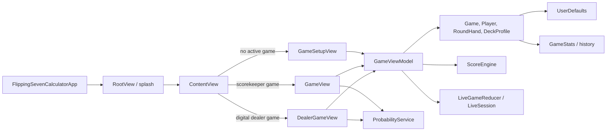

# Architecture And Change Impact

## System Shape

Flipping Seven Calculator is a single-process, offline SwiftUI app with no backend, account system, analytics SDK, or remote synchronization. `UserDefaults` stores Codable game and configuration payloads. The UI is driven by one observable game view model.

## State Ownership

- `ContentView` owns `@State private var viewModel = GameViewModel()` and delegates routing to `ActiveGameRoot` by persisted `playStyle`. Legacy and scorekeeper games use `GameView`; digital dealer games use `DealerGameView`, including its non-destructive unavailable-session recovery state.
- `GameViewModel` is `@Observable`. It owns the active `Game?`, mutation APIs, deck availability, game lifecycle, and in-memory undo/redo stacks.
- Assigning `game` triggers persistence. Mutations generally copy the value-type game, call `saveStateForUndo()`, mutate the copy, then assign it back.
- `Game` owns players, current round index, target score, completed history, active deck profile, active scoring rules, per-mode current-round snapshots, play style, and an optional exact live session.
- `LiveSession` is the dealer source of truth: ordered draw/discard zones, cards on each player, task queue, forced sequences, dealer rotation, deterministic reshuffle state, and audit log. `LiveGameReducer` is the only rules mutation boundary for that state.
- `ProbabilityService` is pure and shared. Calculator calls return an explicitly estimated duplicate-number metric because physical protection is unknown; digital-dealer calls return exact immediate-bust risk from the owned draw pool.
- Views should request mutations from `GameViewModel`; they should not independently persist or duplicate scoring rules.

## Persistence Contract

| Data | Storage key | Owner |
|---|---|---|
| Active game | `currentGame` | `GameViewModel` |
| Last roster | `lastPlayerRoster` | `PersistedRoster` |
| Classic deck | `deckProfile.classic` | `PersistedDeckProfile` |
| Vengeance deck | `deckProfile.vengeance` | `PersistedDeckProfile` |
| Legacy Classic deck fallback | `lastDeckProfile` | `PersistedDeckProfile` |
| Preferences | Individual `@AppStorage` keys | Setup/settings/views |

`Game.playStyle` and `Game.liveSession` are additive fields inside `currentGame`. Legacy payloads default to `scorekeeper` with no live session. The setup preference `lastGameEntryIntent` also defaults to the calculator. `riskInsightsMode` defaults to `off`; `keepScreenAwakeDuringDealer` affects device presentation only and never the shoe.

Persisted model changes must be additive or explicitly migrated. A new non-optional property needs a custom decoder default for old payloads. Renamed enum cases or action keys need normalization. Add tests that decode representative old JSON; a successful build does not establish data compatibility.

Undo/redo is intentionally session-only. It stores up to 50 `Game` snapshots and is not persisted across launches.

## Rules And Scoring

- `DeckProfile.swift` defines `GameMode`, `ScoringRules`, default deck composition, special numbers, and action-card identifiers.
- `RoundHand.swift` represents selected score-relevant cards and mode-specific modifiers.
- `ScoreEngine.swift` is the pure arithmetic boundary. Keep it independent from SwiftUI and persistence.
- `LiveGame.swift` defines the versioned Classic deck factory, live task model, and deterministic reducer. Views issue commands; they never pop cards or resolve actions themselves.
- Drawdown reshuffles only the discard pile. Cards still assigned to players remain outside the shoe. The next shuffle seed is persisted so undo and redraw cannot silently rerandomize the result.
- `GameViewModel` enforces physical deck capacity and applies card/state mutations.
- `Game.endRound()` snapshots enough information for history and statistics to remain correct after the current round resets.
- `GameStats.swift` derives results from completed history; it must use the scoring rules recorded for each round in mixed-mode games.

Classic and Vengeance have independent saved deck profiles. Mid-game mode switching stores per-mode round snapshots, carries overlapping number cards, restores mode-specific entries, keeps scores/history, and clears saved mode progress at the round boundary. Do not simplify this to changing one enum without preserving those invariants.

The verified Vengeance composition, scoring order, compatibility decisions, and source links live in `docs/vengeance-support.md`.

## UI Layers

- `GameSetupView`: roster, target, mode, and game start
- `GameView`: live round orchestration and sheets
- `DealerGameView`: app-owned Classic deck, turn/action guidance, target selection, exact shoe status, and dealer recovery tools
- `RiskInsightView`: compact optional risk disclosure and its explainability sheet
- `PlayerGrid` and scoring components: rapid card/modifier/state entry
- `DeckManagementView`: mode-aware deck customization and active-game mode changes
- `SettingsView`: persistent preferences and default rules
- `GameOverStatsView`: history, charts, and derived statistics
- `OpeningSplashView` and `AppTitleView`: original brand presentation
- `DesignTokens` and `DesignStyles`: semantic color, typography, spacing, shape, shadow, and motion rules

Large views are existing refactor candidates, not permission to perform unrelated rewrites. `GameView`, `GameOverStatsView`, and `GameViewModel` are broad change surfaces; prefer extracting coherent pure helpers or reusable components with tests rather than moving code for its own sake.

## Public Product Surfaces

Changing the product identity may affect all of these:

- `AppBrand.swift`
- Info.plist-generated display-name settings in the Xcode project
- splash/title/help/settings copy
- app icon light, dark, and tinted variants
- App Store metadata JSON and `APP_STORE_LISTING.md`
- screenshots and App Preview media
- privacy/support pages
- accessibility labels
- Apple reviewer notes and legal correspondence

Internal `flip7calculator` names are intentionally stable and are not a public-brand defect.

## Debug And Capture Paths

`AppStoreCaptureFixture` recognizes `-appStoreCapture <fixture>` only in Debug builds. It creates deterministic real model state for screenshots and does not ship in Release behavior. Keep fixture output truthful to production UI and update `AppStoreAssets/<version>/README.md` when capture names or ordering change.

UI tests may use launch arguments and accessibility identifiers to reach deterministic states. Avoid sleeps as the primary synchronization mechanism; wait for semantic elements and state transitions.

## Change-Impact Recipes

### Add Or Change A Card Rule

Review `DeckProfile`, `RoundHand`, `PlayerRound`, `Game`, `ScoreEngine`, `GameViewModel`, score-entry components, history/stats, help copy, capture fixtures, and both unit/UI coverage. Confirm deck counts, duplicate behavior, order of operations, bust handling, manual overrides, undo/redo, Codable defaults, and mixed-mode history.

### Add A Persistent Setting

Choose one stable key, define its default once, decide whether it affects a running game or only future games, expose accessible UI, and test migration/default behavior. Do not silently reinterpret an existing key.

### Change Player Or Round Flow

Review selected-player behavior, player state transitions, `GameFlow`, compact-height scrolling, round completion, undo/redo, and persisted resume. Test at least 2, 4, and 8 players when density or ordering changes.

### Change Shared Styling

Add or refine semantic tokens first, then update consumers. Inspect light/dark appearance, selected/disabled/destructive states, contrast, Dynamic Type, iPad, and Reduce Motion. Regenerate screenshots only after the release UI is stable.

### Add A New Screen

Decide state ownership before building layout. Keep navigation reachable without disrupting live scoring, use existing panel/control styles, add accessibility structure, and include an iPad layout strategy rather than relying on unrestricted stretching.

## Durable Decisions

- Preserve the existing App Store record and internal identifiers.
- Remain offline-first and local-only unless the product direction explicitly changes.
- Keep rules arithmetic pure and view-model mutations undoable.
- Keep Classic and Vengeance configurations independent.
- Use original visual assets and the approved blue/cream/gold language.
- Prefer deterministic command-line verification; use Xcode UI or MCP for visual/debug context, not as the only reproducible path.
