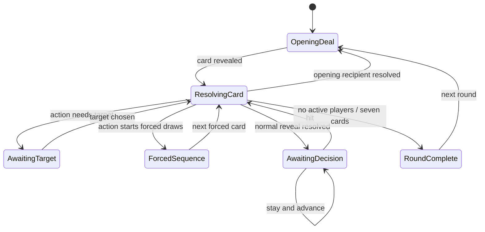

# Live Play, Deck Tracking, and Risk Insights

Product strategy and implementation outline for expanding Flipping Seven Calculator beyond end-of-round score entry.

- Status: proposal only; no implementation is authorized by this document
- Prepared: July 29, 2026
- Scope: product shape, user experience, rules model, architecture, reliability, rollout, and research evidence
- Existing worktree note: this document was intentionally added without modifying the in-progress Vengeance, rebrand, UI, or release work

## Executive recommendation

Build one app with three explicit play styles that share players, scoring, history, deck profiles, and visual language but never compete as simultaneous sources of truth:

1. **Scorekeeper** — the current fast calculator. The physical table remains authoritative.
2. **Deck Tracker** — players use physical cards while the app records every reveal, maintains the shoe and discard pile, guides action resolution, and can provide exact odds after a confirmed shuffle.
3. **Digital Dealer** — the app is the deck and dealer, reveals cards, advances turns, resolves action sequences, scores rounds, and reshuffles automatically.

The recommended delivery order is:

1. Extract an explainable probability service and add carefully labeled risk insights to the calculator.
2. Build the deck ledger and physical Deck Tracker to validate shoe lifecycle, corrections, action resolution, and exact odds without replacing the physical product.
3. Ship a Classic Digital Dealer only after the rules engine, crash recovery, fairness design, user testing, and intellectual-property gate pass.
4. Add Vengeance live play after the Classic state machine has proven reliable.
5. Add optional nearby devices or an external table display only after the single-host experience is excellent.

This sequence is intentionally architecture-led. A superficial Draw button would create a second, divergent game engine and would produce incorrect reshuffles, odds, undo behavior, and action-card handling.

## The product thesis

The core fun is the public decision to push or stop. The app should deepen that moment and remove table chores without making the table stare at a phone.

The product can own these jobs:

- Calculate scores without slowing live play.
- Make the current player, live hand, and next required action unmistakable.
- Maintain a trustworthy draw pile, discard pile, table zones, and reshuffle boundary.
- Resolve complicated action sequences one decision at a time.
- Explain risk without pretending uncertain state is exact.
- Recover from mistaken taps, interruptions, app termination, and low battery without changing the next card.
- Preserve an auditable history of what happened and why a player scored or busted.
- Offer a satisfying table-host experience on one iPhone and a genuinely table-scale experience on iPad.

The app should not initially attempt to own:

- Accounts, cloud sync, public matchmaking, or server-authoritative games.
- AI opponents.
- Camera recognition of third-party cards.
- User-authored action scripts or arbitrary programmable rules.
- A second set of score calculations embedded in SwiftUI.
- Exact win-probability or strategy advice that depends on unmodeled player policies.
- Full digital reproduction of a third-party game without a documented rights decision.

## A non-negotiable product and legal gate

Moving from an independent scorekeeper to an app that supplies the complete deck and rules can make the app a substitute for the physical product. That is a materially different product and risk posture, especially given the existing `APP264401-I` history.

Before public Digital Dealer work:

- Obtain a written product/legal determination about reproducing the complete deck composition and playable rules.
- Prefer a publisher license if the dealer is marketed for a specific third-party game.
- Keep every card face, back, symbol, animation, sound, and term original unless specifically licensed.
- Do not infer that an “independent” disclaimer grants rights.
- If no license is available, position Deck Tracker as the main live companion and limit a Digital Dealer to an original, generic rules profile that stands on its own.

This is product guidance, not legal advice. Apple currently says apps must not use protected third-party material without permission and may reject copycat names, metadata, or representations.

## What the market teaches

### Direct scorekeeper competitors

The direct niche has converged on:

- Card-by-card or manual score entry.
- Automatic modifiers and seven-card bonus calculation.
- Real-time leaderboards.
- Undo.
- Saved games, groups, history, and statistics.
- Vengeance support in newer products.
- Clubs, subscriptions, and online modes in the most expansive competitor.

Those are useful but no longer a defensible destination. Reviews also surface durable table needs:

- Landscape iPad support matters.
- Scores need to scale up when there are fewer players.
- Some groups want one host; others prefer each person to enter their own score.
- Round history and reliable undo are requested repeatedly.
- A single scoring-order bug can invalidate trust in the entire product.

### Generic scorekeepers

Leading generic scorekeepers reinforce these conventions:

- One-touch or natural-gesture scoring.
- Chronological score history and rollback.
- Saved rosters and quick rematches.
- Player colors and labels oriented toward the person around the table.
- Large controls, number-pad escape hatches, and persistent bottom actions.
- Optional timers, starting-player selection, and lightweight game tools.

The current app already has much of the hard foundation: semantic hands, scoring, round history, undo/redo, target progress, per-player color, and persistent rosters.

### Digital deck utilities

Mature deck apps make several table details explicit:

- Tap anywhere or use one dominant control to draw.
- Show remaining-card count only when the user wants it.
- Preserve a card history.
- Mark shuffle boundaries inside history.
- Explain when a settings change requires a new shuffle.
- Offer automatic reshuffle behavior.
- Offer an intentional keep-screen-awake setting.
- Support landscape and iPad rather than stretching an iPhone interface.

These are baseline requirements for Digital Dealer, not polish items.

### Official companion apps

Successful licensed companions remove a role or a chore while leaving the social and tactile core intact:

- One Night automates narration and timing so a player does not have to sit out as narrator.
- HeroQuest can take the game-master role, reveal information gradually, track events, and guide new players while explicitly requiring the physical game.
- Frosthaven's companion emphasizes setup reduction, stateful decks, session resume, optional modules, and undo/redo.

The analogous promise here is “everyone gets to play; the app handles the deck, arithmetic, and housekeeping.”

### Hybrid-board-game research

Recent research classifies digital board-game functions as Timing, Randomizing, Housekeeping, Informing, Teaching, Calculating, Remembering, and Storytelling. This proposal principally uses Randomizing, Housekeeping, Informing, Calculating, and Remembering.

The more important finding is cautionary: automating a physical deck can reduce perceived autonomy, fairness, and challenge when the mechanism becomes opaque. Players in a 2026 study speculated that a digital deck was dynamically changing difficulty even when it was not. The study recommends “just right” hybridity that adds value and deepens the core experience instead of blindly automating components.

Implications for this app:

- Do not hide the deck lifecycle.
- Show draw, discard, and shuffle state in plain language.
- Preserve a chronological table log.
- Never rerandomize because the user undid, relaunched, or changed a visual setting.
- Make odds explainable from visible remaining-card counts.
- Allow groups to turn odds off.
- Keep the push-or-stop decision with the player.
- Test fairness perception, not only mathematical fairness.

## Information architecture

Do not introduce a permanent tab bar that lets users flip between calculator state and dealer state mid-round. The game creation route selects a play style; the active game then presents one authoritative interaction model.

### Setup

Add a `Play Style` choice after ruleset and before the start action:

- **Scorekeeper**
  - “Use your physical deck and enter each player’s cards or score.”
  - Fastest and closest to current behavior.
- **Deck Tracker**
  - “Use your physical deck. Record every reveal for deck counts, guided actions, and exact risk after a shuffle.”
  - Requires additional table input.
- **Digital Dealer**
  - “Use this device as the shared deck and dealer.”
  - No physical deck; availability may be gated by supported rules profiles and rights.

Add an optional `Risk Insights` choice:

- Off.
- Heat only: Low, Rising, High, Critical.
- Exact: percentage plus a short explanation.

The setting should be visible to the table at game start. A host can change it later, but the change should be logged so odds do not appear secretly.

### Lifecycle rules

- `playStyle` is persisted per game and defaults to Scorekeeper for every legacy game.
- Scorekeeper can begin tracking at a confirmed shuffle boundary, not at an arbitrary unknown shoe state.
- Deck Tracker can fall back to Scorekeeper at any time, preserving scores and hands but ending exact deck knowledge.
- Digital Dealer can fall back to Scorekeeper as an emergency escape hatch, but cannot return to the same dealer shoe once deck authority is abandoned.
- Mode or deck-profile changes are locked after a tracked/digital shoe begins. Apply changes only by starting a new game or explicitly rebuilding a shoe at a safe boundary.
- Current calculator mode-switch behavior can remain unchanged; a shuffled live shoe is the reason for the stricter rule.

## The two primary experiences

### Scorekeeper line

Keep the existing selected-player panel and fast number/modifier grid. Add only compact, optional risk information:

- A small `Next draw` risk pill beside the selected player’s round preview.
- Tap the pill for a bottom sheet that explains dangerous ranks and remaining copies.
- Label calculator-only risk as `Estimate` unless the app has tracked the full shoe.
- Do not let the odds panel obscure number entry or add a tap to ordinary scoring.
- Keep manual score, clear, bank/stay, bust, undo, and redo exactly reachable.

### Live line: Deck Tracker and Digital Dealer

Both live styles use the same dealer surface and resolution state machine. Only the source of a revealed card differs:

- Deck Tracker: the host taps the matching card that was physically revealed.
- Digital Dealer: the host taps Draw and the engine removes the committed top card.

This shared pipeline prevents rules drift and makes Deck Tracker a meaningful proof of the later Digital Dealer.

#### Shared dealer surface

- Top: round, target, dealer, draw count, discard count, and an unobtrusive history button.
- Player strip/grid: total score, live round score, number-card count, state, and current-turn emphasis.
- Center: current recipient, last revealed card, and any unresolved instruction.
- Bottom: one dominant context action.
  - `Draw for Maya`
  - `Choose a target`
  - `Continue forced draws (2 left)`
  - `Pass to Leo`
  - `Start next round`
- Secondary action: `Stay` when the current player is allowed to decide.
- Persistent escape: undo last completed table action.
- Risk: a pill close to Draw, never visually larger than the decision controls.

#### iPhone

- Use a vertical host console.
- Keep the current recipient and primary action reachable one-handed near the bottom.
- Allow tapping most of the reveal area to Draw when there is no pending choice.
- Use a horizontally scrolling player strip only if every state remains readable; otherwise use a compact two-column grid.
- Show the live hand as a short horizontal row with an expand affordance.
- Put history, shoe detail, and correction tools in sheets, not the hot path.

#### iPad

- Treat landscape as the primary live-dealer canvas.
- Use a table dashboard: player tiles around or beside a large central deck/reveal area.
- Scale player tiles with roster size; do not leave tiny cards floating in unused space.
- Support portrait, Split View, and Stage Manager without clipping the primary action.
- Consider optional label rotation toward seats only after testing; it helps personal scoreboards but can harm the host’s ability to resolve action choices.

#### Feedback

- Draw: short, neutral haptic and restrained card reveal.
- Bust: distinct error haptic, high-contrast state change, and spoken/visual explanation.
- Seven-card completion: celebratory but brief, with Reduce Motion using a fade and static emphasis.
- Reshuffle: visible interstitial naming how many discarded cards formed the new draw pile.
- Optional spoken dealer: player name, revealed card, and required action. Audio must never be the sole source of state.
- Haptics, sound, spoken dealer, and motion are independently adjustable.

## Exact round and shoe lifecycle

For the supported Classic rules:

1. Create one unique card instance per configured deck count.
2. Shuffle all instances once to form the initial draw pile.
3. Deal one face-up card to every player in turn order, pausing immediately for each action card and then resuming the opening deal.
4. Offer each active player Hit or Stay in turn order.
5. Resolve every revealed card completely before advancing the turn cursor.
6. End the round when no active players remain or a player reaches seven unique number cards.
7. Move all cards from table zones into the discard pile.
8. Pass dealer position left. Do not return the round discard to the draw pile.
9. If the draw pile becomes empty, shuffle the discard pile into a new draw pile while leaving every current-round table card in place.

The official Classic rulebook is explicit that cards from completed rounds remain discarded until the deck runs out and that live table cards stay out during a mid-round reshuffle.

Deck Tracker replaces steps 2 and 9 with human confirmations:

- `I shuffled all available discards` establishes an exact boundary.
- The app then tracks composition, not physical order.
- Every physical reveal subtracts a matching instance from the virtual draw-pile multiset.
- If the recorded card is impossible, stop and offer correction; never silently invent a second copy.

## Resolution state machine

The live engine needs a finite state machine independent of SwiftUI. Suggested phases:

Every phase declares:

- Allowed commands.
- Eligible targets.
- Visible instruction.
- Whether the primary button is enabled.
- Whether undo or cancel returns to the previous stable decision boundary.
- The next phase after resolution.

Do not encode action sequencing as nested sheets and callbacks. The persisted engine phase must be sufficient to resume after termination in the middle of a target choice or forced sequence.

### Classic action handling

- **Freeze**
  - Choose an active target, including self.
  - Bank the target and remove them from normal turn rotation.
- **Flip Three**
  - Choose an active target.
  - Reveal up to three cards one at a time.
  - Stop early on bust or seven-card completion.
  - Second Chance can be retained during the sequence.
  - Defer revealed Freeze or Flip Three actions until the three-card sequence completes and only if the recipient did not bust, following the official sequencing rule.
- **Second Chance**
  - Keep one in the player’s table zone.
  - If the player already has one, choose another eligible active player; discard it if nobody is eligible.
  - On the next duplicate, discard both the duplicate and Second Chance and keep the player active.
  - Preserve the consumed duplicate in the event log even though it no longer appears in the scoring hand.

### Vengeance handling

Vengeance is not a card-label swap. Its live engine additionally needs:

- Distinct identities and duplicate semantics for regular 7, Unlucky 7, regular 13, and Lucky 13.
- Immediate destructive effects for Unlucky 7 while preserving discarded-card history.
- Swap operations that can bust one or both recipients.
- Steal and Discard operations over individual visible card instances.
- Target eligibility that includes stayed/forced-to-stay players where the rules allow it.
- Deferred Flip Four action resolution in reveal order.
- The Zero’s forced-hit behavior.
- Normal and Brutal modifier eligibility.
- Redirected seven-card bonus decisions.
- Negative round outcomes in Brutal mode.

Ship this only after a complete command/transition table exists and passes the publisher rules and FAQ examples.

## Data model direction

### Current limitation

`RoundHand` is optimized for calculation. Sets and count dictionaries cannot represent:

- Two individual copies of the same number temporarily visible on a bust.
- A duplicate discarded by Second Chance.
- Which physical instance moved through Swap, Steal, or Discard.
- Action cards waiting for deferred resolution.
- Draw pile, discard pile, or cross-round shoe history.
- The precise card that undo must return to the top.

Do not overload `RoundHand` into a dealer engine.

### Proposed concepts

- `PlayStyle`
  - `scorekeeper`
  - `physicalDeckTracker`
  - `digitalDealer`
- `RulesVersion`
  - Immutable identifier recorded when a live session begins.
- `CardDefinition`
  - Semantic type and value; never a copyrighted face image.
- `CardInstance`
  - Stable UUID plus definition identifier.
- `CardZone`
  - draw pile, discard pile, player table, deferred action queue, consumed/removed if a supported rule needs it.
- `ShoeState`
  - Ordered draw pile for Digital Dealer.
  - Remaining multiset for Deck Tracker.
  - Discard pile.
  - Shuffle generation and shuffle receipt.
- `LiveRoundState`
  - Dealer seat, turn cursor, opening-deal progress, phase, pending target/action, forced-draw count, and per-player table zones.
- `LiveSession`
  - Play style, rules version, shoe, live round, exactness/confidence, and event ledger.
- `GameCommand`
  - Human intent such as draw, record revealed card, stay, choose target, correct last draw, or confirm physical reshuffle.
- `GameEvent`
  - Facts emitted by the pure reducer, such as card revealed, target chosen, player busted, protection consumed, reshuffled, or round ended.

### Source of truth

Use a pure command reducer:

`(state, command) -> validated new state + events`

- Views render state and send commands.
- ScoreEngine consumes a semantic projection of table zones.
- ProbabilityService consumes public hand state plus shoe composition.
- History and stats consume committed events and completed-round snapshots.
- Persistence stores the authoritative snapshot plus a bounded event ledger.
- Existing `RoundHand` remains the calculator representation and can be produced from live table zones through a tested adapter.

This is not a recommendation to rebuild the current app as pure event sourcing. Persisted snapshots keep resume simple; the event ledger supplies auditability, corrections, insights, and deterministic bug reports.

### Persistence and compatibility

- Add `playStyle` with a `.scorekeeper` decode default.
- Add optional `liveSession`; absence means the legacy calculator model.
- Persist a live state transition before beginning its reveal animation.
- Record a schema version and rules version.
- Keep current games and completed history decodable without generating a fake shoe.
- Do not retroactively infer draw events from legacy hands.
- Consider moving the growing live payload from one `UserDefaults` value to an atomic file-backed Codable store or SwiftData only after measuring payload size and migration cost. The storage mechanism is secondary to atomic snapshots and compatibility tests.

## Undo, correction, and recovery

### Undo semantics

Undo should operate on human decision boundaries, not internal implementation mutations.

- Undo Hit restores the state before that hit and returns every card in its completed resolution chain to its exact prior zone/order.
- Undo never reshuffles and never produces a different replacement card.
- A pending target choice can be canceled back to the state after the action reveal; it cannot erase the action card unless the full draw is undone.
- Undo Stay restores that player to active and returns the turn cursor.
- Undo round completion restores the live table, discard boundary, scores, and dealer position together.
- Redo must replay the same cards and choices.

### Correction tools

Provide an explicit `Table log` with:

- Last completed action and one-tap undo.
- A chronological card/action timeline.
- `Wrong card` replacement for the most recent physical tracked reveal.
- `Missed a card` insertion for Deck Tracker.
- `Move card` or `Change target` only when the engine can validate the resulting state.
- A visible `Odds exactness` consequence before accepting an unknown or untracked correction.

Avoid a general freeform state editor in Digital Dealer. If an exceptional admin override is necessary, mark the session as corrected, log it, and preserve internal invariants.

### Crash and interruption recovery

- Commit the state transition before presenting animation or audio.
- If the app terminates after Draw, relaunch to the already revealed card and pending resolution; never consume another card.
- Restore pending target and forced-draw progress.
- Disable the idle timer only while an active live surface is visible, make the behavior optional, and restore the system default on exit/background.
- Handle calls, lock screen, and backgrounding without auto-advancing.
- If persistence decoding fails, retain the raw payload for diagnostics and offer Scorekeeper recovery rather than silently starting a new game.

## Risk Insights specification

### The only initial headline metric

Use **chance the next revealed card immediately busts the selected recipient**.

Do not label it simply `Bust odds` because that can be mistaken for:

- Chance of busting before the next voluntary choice.
- Chance of eventually busting if the player keeps hitting.
- Chance of losing the game.
- A strategic recommendation.

### Exact calculation

For a draw pile with `N` remaining card instances:

`P(immediate bust on next card) = unsafe remaining instances / N`

Where `unsafe` is not a hard-coded sum of matching number ranks. It is evaluated by the same pure transition logic used by the rules engine:

`unsafe(card) = would drawing this card transition this recipient to busted?`

That distinction is necessary for:

- Second Chance, where a duplicate consumes protection instead of busting.
- Unlucky 7, which has precedence over an existing regular 7.
- Lucky 13, which can coexist with one regular 13.
- Custom profiles whose number-card composition differs.

Example in a fresh Classic shoe with only `2`, `5`, and `9` visible in the selected hand:

- Unsafe remaining instances: `1 + 4 + 8 = 13`.
- Remaining cards: `94 - 3 = 91`.
- Immediate bust chance: `13 / 91 = 14.3%`.

Other visible table cards and discards alter both numerator and denominator. The app should show the contributing ranks so the result is auditable.

### Confidence labels

- **Exact — Digital deck**
  - App owns the order and every zone.
- **Exact — Tracked physical deck**
  - User confirmed a shuffle and every reveal has been recorded consistently.
- **Estimate — Current table only**
  - Based on configured deck and app-visible current cards; prior physical discards are not tracked.
- **Unavailable**
  - Recorded state is impossible, deck profile changed mid-shoe, or an unknown card was skipped.

Never display an unlabeled percentage.

### Risk presentation

The compact pill shows one of:

- `14% next-card risk · Exact`
- `Rising risk · Estimate`
- `Risk unavailable · deck state incomplete`

The expanded sheet shows:

- Exact metric definition.
- Unsafe card instances and total draw-pile count.
- Dangerous ranks with remaining counts.
- Second Chance or special-number effect on the calculation.
- Safe new-number probability and chance the next draw advances toward seven, as a secondary metric.
- A brief note that action and modifier cards may change the turn but do not immediately bust the recipient.

Use redundant encodings: percentage/text, symbol, and a restrained color scale. Do not use green as “you should hit” or red as “you should stay.” The app provides information, not the decision.

### What to defer

- `Expected value if you draw then stay` until every action-target policy is defined.
- `Bust before your next choice` until forced sequences are solved exactly.
- `Chance to reach seven if you always hit` until action selection and protection policies are explicit.
- Match win probability until turn policies, opponent decisions, target choices, and score-position effects are modeled and validated.
- Strategy prescriptions such as “always hit under 20%.” They are opinionated and can be wrong near the target score.

An Odds Lab can later expose those models with stated assumptions, separate from live play.

## Fairness and randomization

### Required

- Materialize unique card instances, then use an unbiased in-place shuffle with Swift's system random generator.
- Inject a deterministic generator in tests.
- Persist the complete shuffled order before the first reveal.
- Never regenerate order during undo, redo, relaunch, visual setting changes, or device rotation.
- Keep shuffle boundaries and counts in the table log.
- Explain in Help that outcomes are not adjusted for score, player, streak, or difficulty.

Apple documents that `SystemRandomNumberGenerator` is automatically seeded and uses a cryptographically secure algorithm whenever possible; Apple platforms use `arc4random_buf`.

### Optional differentiator: shuffle receipt

At shuffle time:

- Serialize ordered card-instance definitions plus a random nonce.
- Store and display a short SHA-256 commitment code.
- At game end or shoe exhaustion, allow export/reveal of the nonce and order for verification.

This proves that the order was not changed after commitment, not that the app's code is globally trustworthy. Position it as an audit receipt, not cryptographic theater. Validate whether real players understand or value it before investing beyond a prototype.

## Statistics and features unlocked by the event ledger

High-value post-game insights:

- Risk percentage accepted on each Hit.
- Average risk at Stay and at Bust.
- Highest-risk safe draw.
- Lowest-probability bust.
- Protection cards gained and consumed.
- Seven-card attempts and completions.
- Cards remaining at every reshuffle.
- Action targets and outcomes.
- Round decision replay with score and risk progression.
- Host correction count, useful for product research and session confidence.

Avoid reducing players to a single “skill” score. Luck and social targeting are central, and opaque rankings would overstate what the data means.

## Opportunity backlog

### Foundation / must-have

- Explicit Scorekeeper, Deck Tracker, and Digital Dealer play styles.
- Immutable card instances and exact zones.
- Pure resolution state machine.
- Classic opening deal, turns, actions, forced sequences, round end, and deck exhaustion.
- Persisted resume at every phase.
- Decision-boundary undo/redo.
- Chronological table log and correction path.
- Exact/estimate/unavailable probability contract.
- iPhone host console and iPad landscape table layout.
- VoiceOver, Dynamic Type, contrast, Reduce Motion, optional sound/haptics.
- Keep-screen-awake option scoped to live play.
- Rules-version and schema-version compatibility.

### Strong second-wave features

- Risk heat mode for groups that dislike explicit percentages.
- Odds Lab / practice sandbox with adjustable hands and deck profiles.
- Post-game decision replay.
- Spoken dealer with adjustable verbosity.
- AirPlay or external-display public scoreboard while the phone remains the host controller.
- Shareable, original-branded game summary image.
- JSON/CSV event export for debugging and playtesting.
- Shuffle receipt.
- A “teach this action” explanation embedded only when a card is first encountered.
- House-rule presets built from supported semantic parameters, not arbitrary scripts.

### Scalable later opportunities

- Nearby read-only player devices joined by QR code.
- Nearby Hit/Stay voting/control with the host as the single authoritative reducer.
- Local peer-to-peer state replication using current Network framework guidance; do not build new work on deprecated Multipeer APIs.
- Apple Watch or lock-screen remote for the host only if it materially reduces table reach friction.
- Original additional rules profiles implemented behind a `Ruleset` interface.
- Solo practice bots only after live human play is complete and legally cleared.
- Tournament/club statistics only if users demonstrate demand; competitors already crowd this lane.
- Accessibility presets for low vision, color differentiation, one-switch input, and spoken-only dealer support.

### Deliberately defer or reject

- Camera scanning at launch: lighting, sleeves, occlusion, languages, training imagery, and IP create a fragile dependency.
- Cloud accounts as a prerequisite: violates the offline-first strength and adds no value to a shared table MVP.
- Public matchmaking: turns a table companion into a live service with moderation, identity, cheating, latency, and uptime obligations.
- An animated 3D table: spectacle does not justify reduced glanceability or slower decisions.
- Hidden dynamic difficulty or “luck balancing”: destroys trust.
- Reroll after undo: enables card fishing and makes history non-deterministic.
- One blended screen containing full calculator controls and a Draw button: two authorities create impossible state.

## Ruleset scalability

Define an internal ruleset boundary that supplies:

- Deck factory and supported customizations.
- Card definitions and labels.
- Valid commands by phase.
- Target eligibility.
- Pure card-resolution transitions.
- End conditions.
- Semantic hand projection for ScoreEngine.
- Immediate-risk evaluation.
- Help copy and accessibility descriptions.

Do not build a general user-facing rules DSL. Strongly typed Classic and Vengeance implementations are easier to validate, migrate, and explain. Generalize only from two proven rulesets and original future profiles, not from imagined extensibility.

Custom deck behavior:

- Scorekeeper can continue accepting custom counts.
- Deck Tracker/Digital Dealer should only start if every configured definition has implemented live semantics.
- Changing counts requires a new shoe.
- Unknown action keys make live play unavailable with a clear reason; they must not be treated as inert cards.

## Verification strategy

### Pure rules and model tests

- Exact default deck instances and unique IDs.
- Shuffle preserves the multiset and count.
- Every card is in exactly one zone.
- Draw + undo + redo preserves order and identity.
- Round end moves only table cards to discard.
- Mid-round exhaustion reshuffles discard but excludes all live table cards.
- Opening-deal actions pause and resume the correct recipient.
- Every Classic action and nested Flip Three sequence.
- Second Chance consumption and reassignment.
- Seven-card completion at every point in a forced sequence.
- No-active-player round completion.
- Decode fixtures for every live schema version and legacy calculator games.

### Probability tests

- Hand-calculated fixtures such as `2, 5, 9` in a fresh shoe.
- Current-table cards removed from numerator and denominator correctly.
- Second Chance changes immediate bust probability to zero while reporting protection-consumption risk separately.
- Special 7 and 13 transitions use rule semantics, not labels.
- Exhaustive comparison: probability numerator equals the count of individual remaining instances that cause the reducer to bust.
- Monte Carlo checks detect gross shuffle or probability errors without replacing exact unit assertions.
- No NaN, negative, above-100%, or nonzero risk with an empty/unavailable pile.

### State-machine tests

- Invalid commands leave state unchanged and return a precise reason.
- Every pending phase survives encode/decode.
- Commands are idempotent where duplicate delivery is possible.
- A draw cannot be accepted twice from a double tap.
- Correction commands preserve zone counts.
- Mode/profile changes are rejected once the shoe is live.
- Rules version remains fixed across app upgrades and resume.

### Fault and endurance tests

- Terminate after every transition boundary and verify exact resume.
- Interrupt during reveal animation, target selection, forced draw, round end, and reshuffle.
- Hundreds of seeded full games with zone and score invariants checked after every event.
- Maximum player count, custom deck limits, repeated reshuffles, and long game histories.
- Corrupt/truncated persistence fixture with non-destructive recovery.
- Rapid repeated Draw taps and accessibility activation.

### UI and table tests

- iPhone SE-class compact height, standard iPhone, and large iPhone.
- iPad mini and regular iPad in portrait and landscape.
- Split View and Stage Manager widths.
- 2, 4, and 8 players; extend to every supported live roster size before release.
- Light/dark, largest useful Dynamic Type, VoiceOver, Voice Control, Switch Control where feasible, Reduce Motion, and haptics/sound disabled.
- Card reveal visible to players across a real table.
- Primary action usable one-handed by a seated host.
- No state conveyed solely through card animation, color, haptic, or audio.

Use existing Make targets and add narrow reducer/probability suites. A release candidate should escalate through the repository's full verification and physical-device checks.

## Product research plan

Do not validate only with internal demos. Test these distinct cohorts:

- Existing users who want the fastest possible calculator.
- One designated host using an iPhone.
- Groups sharing an iPad in landscape.
- New players who need action guidance.
- Experienced players who count cards and care about odds.
- Players who explicitly dislike phones at the table.
- VoiceOver and large-text users.

Run comparison sessions:

1. Physical deck + current Scorekeeper.
2. Physical deck + Deck Tracker.
3. Digital Dealer.

Measure:

- Time from setup to first draw.
- Seconds and taps per ordinary Hit/Stay cycle.
- Host attention on device versus people/table.
- Wrong-player, wrong-card, and wrong-target errors.
- Recovery time from a deliberate mistaken tap.
- Ability to explain why the last outcome occurred.
- Confidence that the deck was fair.
- Understanding of the probability label.
- Preference by task, not just overall novelty.
- Whether odds increase thoughtful tension or drain it.
- Whether the app removes a chore or becomes the center of attention.

Release only when Scorekeeper remains no slower, Deck Tracker produces exact state without unacceptable input burden, and Digital Dealer feels fair and socially legible.

## Phased delivery and exit gates

### Phase 0 — decision and prototype specification

- Choose licensed-specific versus original-generic Digital Dealer direction.
- Finalize public terminology and original card visual language.
- Build a complete Classic transition table on paper.
- Prototype the iPhone and iPad live surfaces without production persistence.
- Conduct fairness and table-attention tests.

Exit: legal/product direction decided; users can identify current player/action instantly; transition table has no unresolved Classic rule.

### Phase 1 — probability foundation

- Pure ProbabilityService using deck profile and semantic transitions.
- Estimate confidence contract.
- Compact calculator risk pill and explanation sheet.
- Odds off by default for existing users until preference is chosen.
- Odds Lab optional if it does not delay live foundations.

Exit: exact fixtures and reducer-comparison tests pass; no metric is presented without definition/confidence.

### Phase 2 — physical Deck Tracker

- Card instances, zones, shoe multiset, event ledger, state machine, table log, and corrections.
- Classic actions and round/deck lifecycle.
- Exact physical-deck odds after confirmed shuffle.
- Persisted resume and decision-boundary undo.

Exit: complete seeded and real-table Classic sessions survive corrections, exhaustion, and termination with no zone divergence.

### Phase 3 — Classic Digital Dealer

- Ordered committed shoe and one-tap Draw.
- Fairness explanation and optional shuffle receipt.
- Live iPhone/iPad layouts, feedback, accessibility, keep-awake behavior.
- Emergency fallback to Scorekeeper.

Exit: rights gate passed; rules audit passes; fairness perception and table usability meet research thresholds; full regression suite passes.

### Phase 4 — Vengeance live engine

- Special numbers, all action transfers, deferred sequences, stayed-player eligibility, and Brutal rules.
- Rules examples and official FAQ encoded as fixtures.
- Vengeance-specific probability semantics.

Exit: full command table and official examples pass; no Classic regression; mixed existing history remains stable.

### Phase 5 — shared displays and nearby clients

- External public scoreboard first.
- Read-only nearby clients second.
- Player Hit/Stay input last, with host authority and disconnect fallback.

Exit: single-device play remains complete; connectivity never blocks or corrupts a local game.

## Decision register

Decisions recommended now:

- Preserve Scorekeeper as the default and fastest line.
- Name and model Deck Tracker separately from Digital Dealer.
- Use one rules reducer for both live styles.
- Make immediate next-card bust probability the first and only headline risk metric.
- Display confidence on every probability.
- Lock deck/mode after a live shoe begins.
- Ship Classic before Vengeance live play.
- Keep a snapshot plus event ledger; do not rewrite the current app into event sourcing.
- Keep online/multi-device out of the MVP.

Decisions that require owner input before implementation:

- Whether a playable third-party-specific digital deck will be licensed, legally reviewed, or replaced by an original generic profile.
- Whether exact odds default to off, heat, or percentage for new games.
- Whether Deck Tracker is valuable enough despite recording every physical reveal.
- Whether Digital Dealer should require physical product ownership even if technically unnecessary.
- Whether the app should speak card/player names by default or remain quiet.

## Sources

### Primary rules and product

- [Classic product page and official rules download](https://www.asmodee.ca/en/product/flip-7/)
- [Classic rulebook, ruleset edition 3.1](https://cdn.svc.asmodee.net/production-asmodeeca/uploads/2025/12/FLIP_7-RULES.pdf)
- [Asmodee UK gameplay and deck lifecycle overview](https://www.asmodee.co.uk/blogs/news/how-to-play-flip-7)
- [The Op Games Classic FAQ](https://theop.games/pages/flip-7-faqs)
- [Vengeance official product page](https://theop.games/products/flip-7-with-a-vengeance)
- [Vengeance official FAQ](https://theop.games/pages/flip-7-wav-faqs)
- [Vengeance ruleset edition 1](https://gamers-hq.de/media/pdf/fd/17/0a/26_FLIP_7_VENGEANCE_RULES_C.pdf)

### Direct and adjacent products

- [Flip & Score App Store listing](https://apps.apple.com/us/app/flip7-score/id6747075064)
- [FlipScore App Store listing](https://apps.apple.com/us/app/flipscore-flip-7-scorekeeper/id6760599005)
- [Flip 7 Score App Store listing](https://apps.apple.com/us/app/flip-7-score-keeper/id6760317673)
- [Flip 7 Score Google Play listing](https://play.google.com/store/apps/details?id=com.flip7score)
- [Unofficial browser-based full digital implementation](https://flip7cards.com/)
- [Board Game Stats App Store listing](https://apps.apple.com/us/app/board-game-stats/id892542000)
- [Board Game Stats score sheets](https://www.bgstatsapp.com/score-sheets/)
- [Score Anything App Store listing](https://apps.apple.com/us/app/score-anything-scorekeeper/id1541777240)
- [GameScore App Store listing](https://apps.apple.com/us/app/gamescore-scorekeeper/id1164683696)
- [Score Keeper for Game Night App Store listing](https://apps.apple.com/us/app/score-keeper-2020/id1245390236)
- [Deck of Cards virtual dealer App Store listing](https://apps.apple.com/us/app/deck-of-cards-virtual-deal/id1191150977)
- [Draw a Card custom-deck App Store listing](https://apps.apple.com/us/app/draw-a-card-deck/id838900770)
- [One Night official companion App Store listing](https://apps.apple.com/us/app/one-night/id728175611)
- [HeroQuest official companion overview](https://apps.hasbro.com/en-IN/heroquest-companion-app)
- [Frosthaven official companion App Store listing](https://apps.apple.com/us/app/frosthaven-official-companion/id6443837203)

### Research and platform guidance

- [Hybrid technologies for tabletop games — University of Melbourne](https://cis.unimelb.edu.au/research/hci/projects/hybrid-digital-boardgames)
- [Unpacking Boardgames with Apps: The Hybrid Digital Boardgame Model](https://doi.org/10.1145/3411764.3445077)
- [Getting Hybridity Just Right: The Goldilocks Factor in Hybrid Digital Boardgames](https://doi.org/10.1145/3772318.3791963)
- [Apple App Review Guidelines](https://developer.apple.com/app-store/review/guidelines/)
- [Apple Human Interface Guidelines: Designing for games](https://developer.apple.com/design/human-interface-guidelines/designing-for-games/)
- [Apple Human Interface Guidelines: Accessibility](https://developer.apple.com/design/human-interface-guidelines/accessibility/)
- [Apple Human Interface Guidelines: Playing haptics](https://developer.apple.com/design/human-interface-guidelines/playing-haptics/)
- [Swift SystemRandomNumberGenerator](https://developer.apple.com/documentation/swift/systemrandomnumbergenerator)
- [CryptoKit SHA-256](https://developer.apple.com/documentation/cryptokit/sha256)
- [SwiftUI state restoration](https://developer.apple.com/documentation/swiftui/restoring-your-app-s-state-with-swiftui)
- [UIApplication idle timer behavior](https://developer.apple.com/documentation/uikit/uiapplication/isidletimerdisabled)
- [Apple Network framework](https://developer.apple.com/documentation/network)

